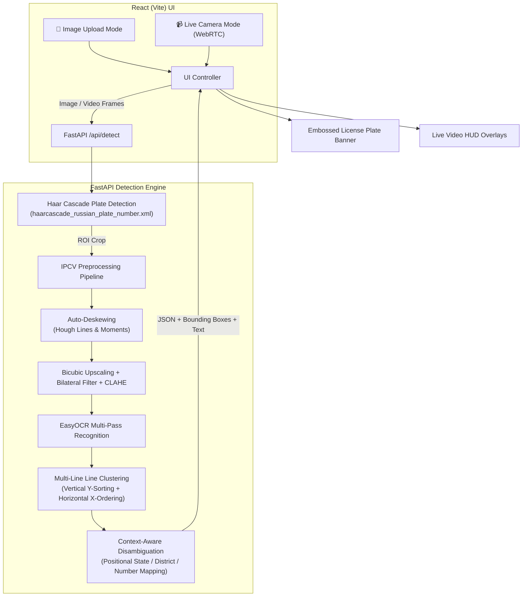

# 🚗 Automatic Number Plate Recognition (ANPR / ALPR) System

A real-time vehicle license plate detection and optical character recognition (OCR) application built using **OpenCV**, **EasyOCR**, **FastAPI**, and **React**.

---

## 📌 Table of Contents

- [Overview](#-overview)
- [System Architecture](#-system-architecture)
- [Key Features](#-key-features)
- [IPCV & Computer Vision Pipeline](#-ipcv--computer-vision-pipeline)
- [Project Structure](#-project-structure)
- [Tech Stack](#-tech-stack)
- [Getting Started](#-getting-started)
  - [Prerequisites](#prerequisites)
  - [Backend Setup](#1-backend-setup)
  - [Frontend Setup](#2-frontend-setup)
- [Running the System](#-running-the-system)
  - [Full Stack Application](#full-stack-web-application)
  - [Standalone Python Scripts](#standalone-python-scripts)
- [API Reference](#-api-reference)
- [Troubleshooting](#-troubleshooting)

---

## 📖 Overview

This project provides an end-to-end solution for detecting vehicle number plates from either static images or live camera video streams and recognizing the alphanumeric license plate characters with high accuracy. 

It handles real-world computer vision challenges such as:
- **Tilted / perspective-skewed plates**
- **2-line / multi-line vehicle plates**
- **Ambiguous character pairs** (`G` vs `6`, `1` vs `I`, `0` vs `O`, `8` vs `B`, `5` vs `S`, `2` vs `Z`)

---

## 🏗 System Architecture



---

## ✨ Key Features

1. **Dual Detection Modes**:
   - **Upload Image Mode**: Drag-and-drop or select high-resolution car photos to inspect bounding boxes, cropped plates, and recognized text.
   - **Live Camera Mode**: Real-time webcam streaming with an animated HUD laser, live bounding box overlays, and real-time detection cards.

2. **Automatic Tilt Correction (Deskewing)**:
   - Uses probabilistic Hough line transforms and contour minimum-area bounding boxes to compute plate angles ($\pm 1.5^\circ$ to $\pm 35^\circ$).
   - Straightens rotated license plates before text extraction using affine warp matrices (`cv2.warpAffine`).

3. **Multi-Line (2-Line) Plate Support**:
   - Clusters OCR text bounding boxes by vertical centroids to separate lines.
   - Sorts rows top-to-bottom and tokens left-to-right, seamlessly joining lines (e.g., `DL 01` + `AB 1234` $\rightarrow$ `DL 01 AB 1234`).

4. **Context-Aware Character Disambiguation**:
   - Resolves classic optical character recognition confusion across all plate slots:
     - **Digit slots (district & vehicle number)**: Forces digits, mapping `Q`/`O`/`D` $\rightarrow$ `0` (e.g. `12Q4` $\rightarrow$ `1204`, `MHQ2` $\rightarrow$ `MH 02`), `I`/`L` $\rightarrow$ `1`, `Z` $\rightarrow$ `2`, `E` $\rightarrow$ `3`, `A` $\rightarrow$ `4`, `S` $\rightarrow$ `5`, `G`/`b` $\rightarrow$ `6`, `T`/`Y` $\rightarrow$ `7`, `B` $\rightarrow$ `8`, `P`/`q` $\rightarrow$ `9`.
     - **Letter slots (state code & series)**: Forces letters, mapping `0L`/`QL` $\rightarrow$ `DL`, `6J` $\rightarrow$ `GJ`, `M8` $\rightarrow$ `MH`, `K4` $\rightarrow$ `KA`, `1N`/`7N` $\rightarrow$ `TN`, `0P`/`QP` $\rightarrow$ `UP`, `0D`/`QD` $\rightarrow$ `OD`, `8H` $\rightarrow$ `BH`.
     - **Series disambiguation**: Safely protects series letters from being converted to numbers (e.g. `MH12 AB1234` preserves `AB` instead of turning into `48`).

5. **Realistic Embossed License Plate Banner**:
   - Modern UI displaying realistic license plate styling with country/state strip (`IND`), embossed monospace typography, and a one-click clipboard copy button.

---

## 🔬 IPCV & Computer Vision Pipeline

| Step | Technique | Purpose |
|---|---|---|
| **1. Detection** | OpenCV Haar Cascade Classifier | Identifies candidate license plate regions of interest (ROI). |
| **2. Padding** | Dynamic 5% Boundary Expansion | Prevents clipping edge characters (like `DL` or `4`). |
| **3. Deskewing** | HoughLinesP + Affine Transform | Corrects tilted or perspective-skewed plates. |
| **4. Super-Resolution** | Bicubic Upscaling (`INTER_CUBIC`) | Normalizes low-resolution crops to minimum 95px height. |
| **5. Denoising** | Bilateral Filter (`9, 75, 75`) | Denoises background while preserving sharp character edges. |
| **6. Contrast Boost** | CLAHE (`clipLimit=2.5, tileGrid=8x8`) | Equalizes uneven shadows and glare. |
| **7. Binarization** | Otsu's Thresholding | Generates high-contrast binary text masks. |
| **8. Recognition** | EasyOCR (CRAFT + ResNet-BiLSTM-CTC) | Extracts character bounding boxes and probabilities. |
| **9. Post-Processing** | Positional Regex & Lexical Mapping | Fixes optical confusions (`G`/`6`, `1`/`I`, `O`/`0`, `S`/`5`). |

---

## 📁 Project Structure

```
ipcv project/
├── backend/
│   └── app.py                  # FastAPI server with IPCV pipeline & OCR endpoints
├── frontend/
│   ├── src/
│   │   ├── App.jsx             # React component (Upload + Live Camera UI)
│   │   ├── App.css             # Dark neon HUD & embossed license plate styles
│   │   └── main.jsx            # React root entry point
│   ├── package.json            # Frontend dependencies & scripts
│   └── vite.config.js          # Vite configuration & proxy settings
├── number_plate.py             # Standalone image detector script
├── ocr_plates.py               # Standalone batch OCR script
├── number_plate_auto.py        # Standalone webcam detector with Excel export
├── generate_test_image.py      # Synthetic test vehicle image generator
├── requirements.txt            # Python package dependencies
├── sample_plate.jpg            # Sample 2-line test vehicle plate
├── tilted_2line_plate.jpg      # Sample tilted 2-line test vehicle plate
└── README.md                   # Project documentation
```

---

## 💻 Tech Stack

- **Backend**: Python 3, FastAPI, Uvicorn, OpenCV (`opencv-python`), EasyOCR, PyTorch, NumPy
- **Frontend**: React 18, Vite 5, Modern CSS (Glassmorphism & Neon HUD)
- **Data Export**: OpenPyXL (Excel)
- **Computer Vision Model**: OpenCV Haar Cascade (`haarcascade_russian_plate_number.xml`) + EasyOCR CRAFT Text Detection & Recognition

---

## 🚀 Getting Started

### Prerequisites

- **Python**: 3.9 to 3.12+ installed
- **Node.js**: v18+ and npm installed

---

### 1. Backend Setup

1. Open your terminal and navigate to the project directory:
   ```bash
   cd "/Users/varun/Desktop/ipcv project"
   ```

2. Create and activate a Python virtual environment:
   ```bash
   python3 -m venv venv
   source venv/bin/activate
   ```

3. Install backend dependencies:
   ```bash
   pip install -r requirements.txt
   pip install "fastapi[standard]" python-multipart "opencv-python<5"
   ```

---

### 2. Frontend Setup

1. Open a new terminal tab and navigate to the `frontend/` directory:
   ```bash
   cd "/Users/varun/Desktop/ipcv project/frontend"
   ```

2. Install Node dependencies:
   ```bash
   npm install
   ```

---

## ⚡ Running the System

### Full Stack Web Application

1. **Start the FastAPI Backend** (Terminal 1):
   ```bash
   cd "/Users/varun/Desktop/ipcv project/backend"
   source ../venv/bin/activate
   python -m uvicorn app:app --host 0.0.0.0 --port 8000
   ```
   *Backend running at:* `http://localhost:8000`  
   *Swagger documentation:* `http://localhost:8000/docs`

2. **Start the React Frontend** (Terminal 2):
   ```bash
   cd "/Users/varun/Desktop/ipcv project/frontend"
   npm run dev -- --host 0.0.0.0 --port 5174
   ```
   *Frontend running at:* `http://localhost:5174`

3. Open **[http://localhost:5174](http://localhost:5174)** in your web browser:
   - Click **Upload Image** to test with vehicle images (`sample_plate.jpg` or `tilted_2line_plate.jpg`).
   - Click **Live Camera** and click **Start Camera** to detect number plates directly through your webcam in real-time.

---

### Standalone Python Scripts

The project also includes standalone CLI scripts for offline processing:

1. **Detect plates in a static image**:
   ```bash
   python number_plate.py sample_plate.jpg
   ```
   *Saves cropped plates into `plates/` and annotated image to `result.jpg`.*

2. **Run batch OCR on all saved plates in `plates/`**:
   ```bash
   python ocr_plates.py
   ```

3. **Webcam detection with instant Excel logging**:
   ```bash
   python number_plate_auto.py
   ```
   *Press `s` to capture and OCR the detected plate; press `q` to quit and export to `detected_plates.xlsx`.*

---

## 📡 API Reference

### Health Check
```http
GET /api/health
```
**Response:**
```json
{
  "status": "ok",
  "ocr_ready": true,
  "ocr_loading": false,
  "cascade_model": "haarcascade_russian_plate_number.xml"
}
```

---

### Detect License Plates
```http
POST /api/detect
```
**Parameters (multipart/form-data):**
- `image` *(required)*: Binary image file (`.jpg`, `.png`, `.webp`)
- `run_ocr` *(optional, default: true)*: Boolean toggle for text extraction
- `min_area` *(optional, default: 250)*: Minimum bounding box pixel area

**Response:**
```json
{
  "success": true,
  "plates": [
    {
      "bbox": [167, 248, 272, 91],
      "bbox_norm": [0.2783, 0.62, 0.4533, 0.2275],
      "text": "DL 01 AB 1234",
      "confidence": 0.917
    }
  ],
  "annotated_image": "data:image/jpeg;base64,...",
  "plate_images": ["data:image/jpeg;base64,..."],
  "processed_images": ["data:image/jpeg;base64,..."],
  "image_size": {
    "width": 600,
    "height": 400
  },
  "ocr_ready": true
}
```

---

## ❓ Troubleshooting

| Issue | Cause | Solution |
|---|---|---|
| `Address already in use (Port 5000)` | macOS AirPlay Receiver occupies port 5000 by default. | The backend is configured to use port `8000`. |
| `Camera access denied in terminal` | macOS privacy sandbox restrictions on command-line binaries. | Use **Live Camera Mode** in the browser (`http://localhost:5174`), which accesses the camera natively via standard browser permissions. |
| `cv2 has no attribute CascadeClassifier` | OpenCV 5.x build issue. | Ensure OpenCV 4.x is installed: `pip install "opencv-python<5"`. |
| `Low confidence on blurry plates` | Motion blur or low lighting. | Ensure the plate is well lit and within reasonable focus distance. The built-in CLAHE and bicubic filters automatically normalize contrast. |

