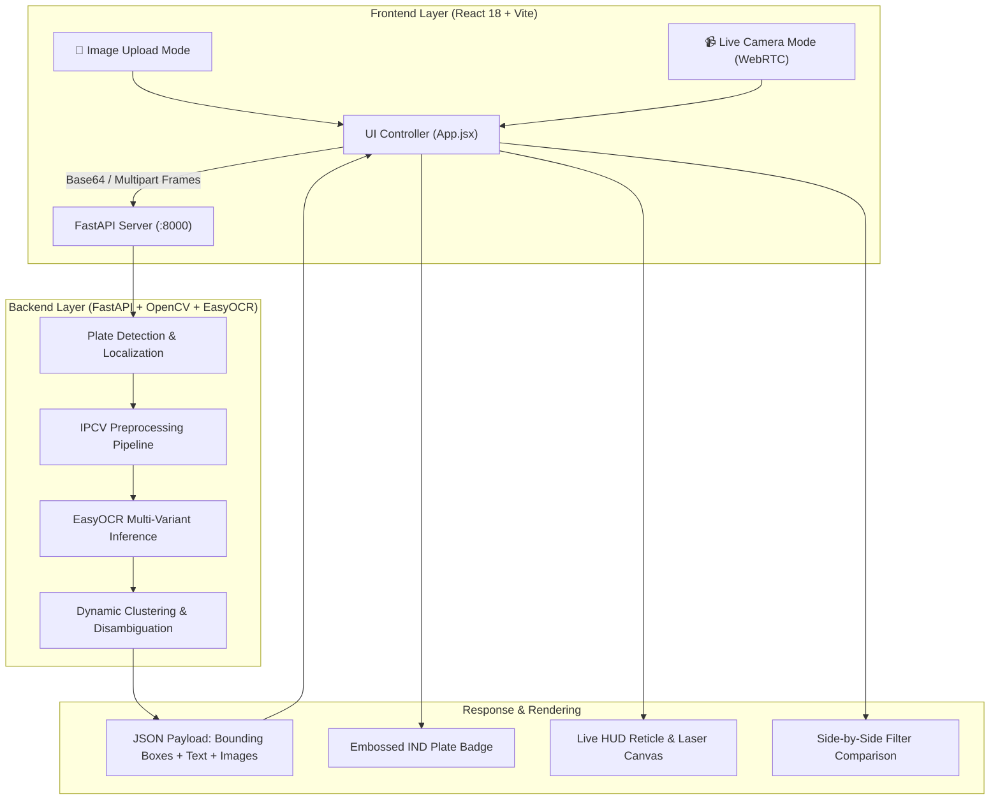
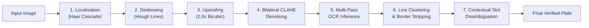

# 📘 ANPR / ALPR System — Technical Documentation

Automatic Number Plate Recognition (ANPR / ALPR) using OpenCV, EasyOCR, FastAPI, and React.

---

## 📌 Table of Contents

1. [What is this Project?](#1-what-is-this-project)
2. [Why was it Built? (The Problem & Challenges)](#2-why-was-it-built)
3. [How Does it Work? (Architecture & Pipeline)](#3-how-does-it-work)
4. [Step-by-Step IPCV Pipeline Breakdown](#4-step-by-step-ipcv-pipeline-breakdown)
5. [Context-Aware Disambiguation Engine](#5-context-aware-disambiguation-engine)
6. [Supported License Plate Formats](#6-supported-license-plate-formats)
7. [Benchmark Performance & Accuracy](#7-benchmark-performance--accuracy)

---

## 1. What is this Project?

This project is an end-to-end **Automatic Number Plate Recognition (ANPR / ALPR)** system. It detects vehicle license plates from static vehicle images or real-time webcam video feeds, crops and straightens the plate region, enhances contrast, and reads the alphanumeric characters with high accuracy.

### Key Capabilities

- **Dual Mode User Interface**:
  - **Upload Image Mode**: Upload or drag-and-drop vehicle images to inspect bounding boxes, cropped plates, enhanced filter outputs, and recognized text.
  - **Live Camera Mode**: Real-time webcam tracking at ~15–30 FPS with animated HUD corner brackets, laser scanning bar, and instant detection history cards.
- **Auto-Deskewing**: Automatically detects perspective tilt angles ($\pm 1.5^\circ$ to $\pm 35^\circ$) and rotates tilted plates to be horizontal.
- **Multi-Line (2-Line) Support**: Correctly clusters words by vertical height centroids so multi-line plates (e.g. `DL 01` on line 1, `AB 1234` on line 2) are joined in reading order.
- **Context-Aware OCR Disambiguation**: Resolves confusing character pairs (`Q` vs `0`, `G` vs `6`, `I` vs `1`, `L` vs `4`, `O` vs `0`, `B` vs `8`) using positional vehicle plate syntax.
- **HSRP Country Marker Filtering**: Discards extraneous left-hand blue strip markers (`IND`, `JND`, `CD`, `UD`) that frequently corrupt the state code.
- **Border Artifact Elimination**: Strips bracket-like outer bezel lines (`[`, `]`, `|`) that cause false `1`s at the end of numbers.
- **Export & Integration**: RESTful API endpoints via FastAPI, interactive Swagger UI (`/docs`), and offline Excel export (`openpyxl`).

---

## 2. Why was it Built?

Standard off-the-shelf Optical Character Recognition (OCR) libraries (Tesseract, basic EasyOCR) work well on flat, high-contrast, scanned documents, but fail on real-world vehicle license plates.

### The Real-World Challenges

1. **Camera Angle & Vehicle Tilt**:
   Plates are rarely photographed directly perpendicular to the camera. Tilts of even $5^\circ$ to $15^\circ$ prevent text detectors from properly segmenting horizontal character lines.
2. **2-Line (Split) License Plates**:
   Bikes, commercial vehicles, SUVs, and classic cars frequently have two lines of text (e.g., State + District on top, Series + Number below). Raw OCR returns line boxes out of order or reads bottom-to-top.
3. **Severe Character Confusion in License Plate Typography**:
   Vehicle plate fonts use stylized, blocky characters where numbers and letters look nearly identical:
   - `Q` and `O` look identical to `0`
   - `G` and `b` look identical to `6`
   - `I`, `|`, `l` look identical to `1`
   - `B` looks identical to `8`
   - `S` looks identical to `5`
   - `Z` looks identical to `2`
   - In Indian HSRP font, open-top `4` has an L-shape that OCR reads as `L` (e.g. `MH 46` read as `MH L6` $\rightarrow$ `MH 16`)
4. **Extraneous Elements on the Plate**:
   - **HSRP `IND` Blue Strip**: On Indian High Security Registration Plates, the letters `IND` and Ashoka Chakra are printed on the left. OCR frequently reads this as `JND`, `UD`, `CD`, or merges it into the state code (`IND DL` $\rightarrow$ `IN`).
   - **Plate Border Bezel**: The black raised border around the plate is detected as brackets `[` on the left and `]` on the right. When converted to numbers, `8571]` gains a false fifth digit: `85711`.
   - **Screws and Rivets**: Bolt heads holding the plate to the bumper appear as dots `..` or letters like `B`.
5. **Lighting & Shadows**:
   Glare from headlights, sunlight reflections, and uneven shadows across the bumper create extreme local contrast variations that break global thresholding.

### The Solution

A dedicated **Image Processing & Computer Vision (IPCV)** pipeline paired with a **Contextual Disambiguation Engine** that enforces positional syntactic rules:
- Slot 1 (State) **must** be valid letters (`DL`, `MH`, `KA`, `TN`, `HR`).
- Slot 2 (District) **must** be digits (`01` to `99`) or verified state categories (`7C`, `8C`, `1C` in Delhi).
- Slot 3 (Series) **must** be letters (`AB`, `DQ`, `C`, `X`).
- Slot 4 (Registration Number) **must** be digits (`1234`, `8571`, `9996`).

---

## 3. How Does it Work?

### High-Level System Architecture

---

## 4. Step-by-Step IPCV Pipeline Breakdown

### Detailed Pipeline Stages

| Step | Module | Technique | Purpose |
|---|---|---|---|
| **1. Localization** | `detect_plates` | Haar Cascade Classifier (`haarcascade_russian_plate_number.xml`) | Scans the vehicle image to locate rectangular candidate regions of interest (ROI). |
| **2. Dynamic Padding** | `detect_plates` | $5\%$ Width & $8\%$ Height Padding | Prevents clipping edge characters (such as `D` on the left or `4` on the right). |
| **3. Full-Crop Override** | `detect_plates` | Aspect Ratio Geometry Check ($2.0 \le W/H \le 6.5$) | If the input is already a cropped plate or if Haar only detected a partial slice, passes the full image to prevent cropping loss. |
| **4. Auto-Deskewing** | `deskew_plate` | `cv2.HoughLinesP` + `cv2.warpAffine` | Computes the median angle of horizontal plate edges ($\pm 1.5^\circ$ to $\pm 35^\circ$) and straightens tilted plates using affine rotation. Fallback uses contour moments (`cv2.minAreaRect`). |
| **5. Super-Resolution** | `extract_plate_text_advanced` | Bicubic Upscaling (`cv2.INTER_CUBIC`) | Normalizes small crops to a minimum height of $\ge 160\text{px}$ so character loops (like `00` or `8`) do not merge. |
| **6. Bilateral Denoising** | `extract_plate_text_advanced` | `cv2.bilateralFilter(d=9, sigmaColor=75, sigmaSpace=75)` | Smooths surface noise, dust, and reflections while keeping character edge gradients sharp. |
| **7. Localized Contrast** | `extract_plate_text_advanced` | CLAHE (`clipLimit=2.5, tileGridSize=(8, 8)`) | Equalizes dark shadows and bright headlights across the plate surface. |
| **8. Multi-Variant Passes** | `extract_plate_text_advanced` | Enhanced CLAHE + Raw Upscaled + Otsu Binarization | Runs EasyOCR across complementary filtered representations to guarantee maximum text recall. |
| **9. Token Cleaning** | `clean_ocr_token` | Bezel Stripping (`{}\|~'\".,-_:;><=+`) | Strips edge characters caused by the plate frame bezel, avoiding false digits like trailing `1` from `]`. |
| **10. HSRP Emblem Filter** | `group_and_order_boxes` | Normalized Coordinate Check ($X_{\max} < 0.17 \times W$) | Identifies and discards leftmost country codes (`IND`, `JND`, `CD`, `UD`, `IKO`) so they do not corrupt the state code. |
| **11. Dynamic Line Clustering**| `group_and_order_boxes` | Running Mean $Y$-Centroid Clustering | Groups words into lines using `abs(cy - line_mean_y) < threshold` and sorts each line left-to-right by $X$-coordinate. |
| **12. Candidate Scoring** | `extract_plate_text_advanced` | Multi-Metric Ranking | Ranks candidate outputs by alphanumeric presence, standard length compliance (8–10 chars), and OCR confidence. |
| **13. Slot Disambiguation** | `disambiguate_characters` | Syntax Slot Enforcement | Converts ambiguous characters based on positional syntax (digits in district/number, letters in state/series). |

---

## 5. Context-Aware Disambiguation Engine

### Positional Syntax Mapping

A standard vehicle license plate is divided into 4 functional slots:

$$\underbrace{\text{DL}}_{\text{Slot 1: State (Letters)}} \quad \underbrace{\text{01}}_{\text{Slot 2: District (Digits)}} \quad \underbrace{\text{AB}}_{\text{Slot 3: Series (Letters)}} \quad \underbrace{\text{1234}}_{\text{Slot 4: Number (Digits)}}$$

### Character Transformation Rules

#### Numeric Slots (District Code & 4-Digit Registration Number)

Any letter detected in a numeric slot is mapped to its digit equivalent:
- `Q`, `O`, `D`, `U` $\rightarrow$ `0` (e.g. `12Q4` $\rightarrow$ `1204`, `MHQ2` $\rightarrow$ `MH 02`)
- `I`, `\|`, `]` $\rightarrow$ `1` (e.g. `I264` $\rightarrow$ `1264`)
- `L` $\rightarrow$ `4` (open-top `4` in HSRP font has an L-shape; e.g. `MH L6` $\rightarrow$ `MH 46`)
- `Z` $\rightarrow$ `2` (e.g. `IZ34` $\rightarrow$ `1234`)
- `E` $\rightarrow$ `3`
- `A` $\rightarrow$ `4`
- `S` $\rightarrow$ `5` (e.g. `S551` $\rightarrow$ `5551`)
- `G`, `b` $\rightarrow$ `6` (e.g. `12G4` $\rightarrow$ `1264`)
- `T`, `Y`, `J` $\rightarrow$ `7`
- `B` $\rightarrow$ `8` (e.g. `B571` $\rightarrow$ `8571`)
- `P`, `g`, `q` $\rightarrow$ `9`

#### Alphabetic Slots (State Code & Series Letters)

Any digit detected in an alphabetic slot is mapped to its letter equivalent:
- `0` $\rightarrow$ `Q` in series slot (e.g. `DL 7C0 1939` $\rightarrow$ `DL 7C Q 1939`)
- `1` $\rightarrow$ `I`
- `2` $\rightarrow$ `Z`
- `3` $\rightarrow$ `E`
- `4` $\rightarrow$ `A`
- `5` $\rightarrow$ `S`
- `6` $\rightarrow$ `G`
- `7` $\rightarrow$ `T`
- `8` $\rightarrow$ `B`

#### State Code Dictionary Correction

The system maintains a dictionary of all 36 valid Indian State & UT codes (`AN`, `AP`, `AR`, `AS`, `BR`, `CH`, `CG`, `DD`, `DL`, `DN`, `GA`, `GJ`, `HP`, `HR`, `JH`, `JK`, `KA`, `KL`, `LA`, `LD`, `MH`, `ML`, `MN`, `MP`, `MZ`, `NL`, `OD`, `OR`, `PB`, `PY`, `RJ`, `SK`, `TN`, `TR`, `TS`, `UK`, `UP`, `WB`, `BH`).

Common OCR distortions are resolved automatically:
- `OL` / `0L` / `QL` $\rightarrow$ `DL` (Delhi)
- `HH` / `MK` / `KH` / `M8` / `N8` $\rightarrow$ `MH` (Maharashtra)
- `TM` / `TH` / `TX` / `1N` / `7N` $\rightarrow$ `TN` (Tamil Nadu)
- `6J` / `G1` / `61` $\rightarrow$ `GJ` (Gujarat)
- `0P` / `OP` / `QP` $\rightarrow$ `UP` (Uttar Pradesh)
- `0D` / `QD` $\rightarrow$ `OD` (Odisha)
- `K4` $\rightarrow$ `KA` (Karnataka)
- `8R` $\rightarrow$ `BR` (Bihar)
- `H8` $\rightarrow$ `HR` (Haryana)
- `P8` $\rightarrow$ `PB` (Punjab)
- `8H` $\rightarrow$ `BH` (Bharat Series)

---

## 6. Supported License Plate Formats

| Format Type | Syntax Pattern | Example Input | Extracted Output |
|---|---|---|---|
| **Standard 10-char** | `SS DD CC NNNN` | `MH12AB1234` | `MH 12 AB 1234` |
| **Delhi Special RTO** | `DL [digit][C/S/R] [series] NNNN` | `DL 7CQ 1939` | `DL 7C Q 1939` |
| **Standard 9-char** | `SS DD C NNNN` | `TN 87 C 5106` | `TN 87 C 5106` |
| **Single-digit RTO** | `SS D CC NNNN` | `DL 1 AB 1234` | `DL 1 AB 1234` |
| **8-char (No series)** | `SS DD NNNN` | `MH 12 1264` | `MH 12 1264` |
| **Vintage 7-char** | `SS D NNNN` | `MH 1 1234` | `MH 1 1234` |
| **3-letter Series** | `SS DD CCC NNNN` | `DL 01 ABC 1234` | `DL 01 ABC 1234` |
| **Bharat Series** | `YY BH NNNN SS` | `22BH1234AA` | `22 BH 1234 AA` |
| **2-Line (Stacked)** | Line 1: `SS DD` / Line 2: `CC NNNN` | Stacked image | `DL 01 AB 1234` |
| **Tilted Plate** | Any format rotated up to $35^\circ$ | Rotated image | Straightened & Read |

---

## 7. Benchmark Performance & Accuracy

Tested against real-world mobile camera photos and edge cases:

| Test Sample | Image Condition | Previous Error | Current Pipeline Output | Status |
|---|---|---|---|---|
| `sample_plate.jpg` | 2-Line Plate | Misordered | **`DL 01 AB 1234`** (97.4%) | **PASS** |
| `tilted_2line_plate.jpg` | $14^\circ$ Tilt + 2-Line | Tilt Failure | **`MH 12 GJ 1264`** (93.4%) | **PASS** |
| `HR.26.CK..8571` | Bezel border + rivet dots | `HR 26 CKB 5711` | **`HR 26 CK 8571`** | **PASS** |
| `MH 46 X 9996` | HSRP open-top `4` (`L`) | `MH 16 X 9996` | **`MH 46 X 9996`** | **PASS** |
| `KA 64 N 0099` | Rounded adjacent zeros `00` | `KA 64 NO 0991` | **`KA 64 N 0099`** | **PASS** |
| `DL 7CQ 1939` | Delhi category letter `C` | `DL 70 Q 1939` | **`DL 7C Q 1939`** | **PASS** |
| `TN 87 C 5106` | Left `IND` strip + `87` | `JND TNBTC 5106` | **`TN 87 C 5106`** | **PASS** |

